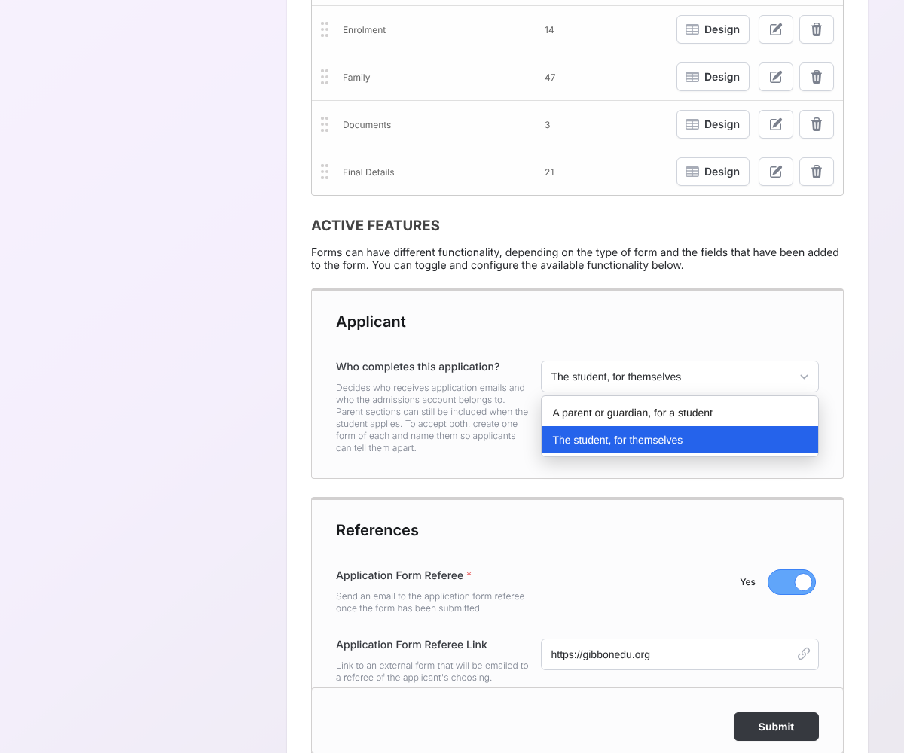
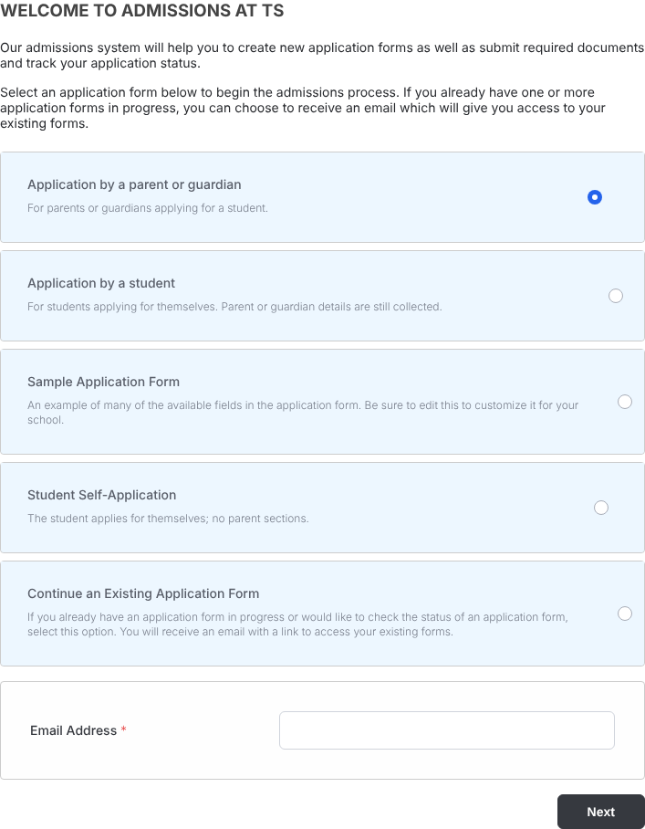

# Gibbon: students applying for themselves, and billing them directly

Lets a student apply to a [Gibbon](https://gibbonedu.org) school or university **for themselves**,
alongside the existing parent-led process, with one setting per application form, and lets their
invoices be sent **to the student**, beside Family and Company. Built and tested
on **Gibbon v30.0.01**. This is not an official Gibbon release: it is shared as evidence for a
discussion with the Gibbon maintainers, and as a tested package for v30.0.01.

**Start here:** [docs/findings.md](docs/findings.md): the design, what was found and fixed, how it
was tested, and how it relates to the Gibbon roadmap.

## The setting

In **System Admin > Form Builder > (form) > Active Features > Applicant**:

**Who completes this application?**

- **A parent or guardian, for a student.** This is the default and Gibbon's existing behaviour; every existing form behaves this way.
- **The student, for themselves.** The student is the applicant. Parent sections can still be on the form, for example contacts or financial aid details.

Emails, the admissions account link and Parent 1 all follow the setting. A school that accepts both
kinds of applicant publishes two forms, named so applicants can tell them apart.

Applicants then choose by choosing the form, on Gibbon's existing admissions page:

## Billing the student

A third choice beside Family and Company, **Student**: invoices go to the student, with their name,
email and address read from their own record. On forms the student completes, "Send Future Invoices
To" offers **Myself**, selected by default. Staff can also set Student in Manage Invoicees. It needs
one database step (`sql/finance_student.sql`), with a rollback script.

## What's here

| Folder | What it is |
|---|---|
| [`v30.0.01/student-applicant`](v30.0.01/student-applicant) | The package: 32 files (one new), the database step for billing the student, an install script with check, backup, verify and rollback, test forms (`sql/test_forms.sql`), and a README with checksums and a hand-test plan. Includes the v30 bug fixes below. |
| [`v30.0.01/hotfix-assignhouse`](v30.0.01/hotfix-assignhouse) | Only the AssignHouse fix and a repair script, for schools that want that fix alone. Already in the package. |
| [`patches`](patches) | The same changes as unified diffs against v30.0.01. |
| [`tests`](tests) | The test harness and end-to-end scripts used to verify the package. |
| [`docs`](docs) | Findings, and the upstream bug reports. |

## v30 bugs fixed on the way

Found while testing; they affect every school, not only student applicants.

| Bug | Development branch (9 Oct 2026) |
|---|---|
| An acceptance email issue | Reported privately to the Gibbon team; details withheld until a fix is released |
| Family page crashes, or cannot be submitted, for an account with a family but no parent linked | Still present; reported in [#2183](https://github.com/GibbonEdu/core/issues/2183) |
| "Submission Email" line missing from the applicant's results page on forms without a Parent 1 email | Still present; reported in [#2184](https://github.com/GibbonEdu/core/issues/2184) |
| Online invoice payment receipt has a blank status and no payment details when the payer is logged in | Still present; reported in [#2201](https://github.com/GibbonEdu/core/issues/2201) |
| Online payment receipt for a Company invoice goes to the family, not the company | Still present; reported in [#2202](https://github.com/GibbonEdu/core/issues/2202) |
| Admissions Family tab shows an empty "New Parent" row on forms without Parent 1, and labels the applicant as their own sibling | Still present (16 Oct 2026); reported in [#2207](https://github.com/GibbonEdu/core/issues/2207) |
| Auto House Assign writes every new student's house to person 1 | Fixed ([PR #2121](https://github.com/GibbonEdu/core/pull/2121)) |

Reports as filed: [docs/upstream-bug-reports.md](docs/upstream-bug-reports.md).

## Status

| | |
|---|---|
| Tested | Automated suites on a fresh v30.0.01 install with demo data; comparison runs on stock v30.0.01 |
| Hand-tested | Installed with its own script on a fresh v30.0.01 site with demo data on a live host; all seven hand tests passed |
| Payments | PayPal sandbox on the same site: application submission and processing fees on the student and parent forms, and invoices paid online after acceptance |
| Billing the student | 34 / 34 automated checks on a local v30.0.01; hand tests 8 to 13 passed on the live site with the PayPal sandbox |
| Open | Reusing the existing student and parents when someone applies again (waits for upstream discussion) |

## Installing on v30.0.01

See [`v30.0.01/student-applicant/README.md`](v30.0.01/student-applicant/README.md). In short, from
the Gibbon webroot:
1. Run `bash student-applicant.sh check`.
2. Run `sql/finance_student.sql`, one step at a time.
3. Run `backup`.
4. Upload the `src` and `modules` folders (32 files).
5. Run `verify`.

**v30.0.01 only:** do not copy these files over a different version.

Earlier versions of this repository had separate Phase 1 and Phase 2 folders, which decided "student
applicant" from the absence of parent fields. They are replaced by this package and remain in the
git history.

## Licence

Gibbon is free software under the GNU General Public License v3.0. The files in this repository are
modified Gibbon files and are distributed under the same licence; see [LICENSE](LICENSE).

Tieku Bortei-Doku, High Point Education Solutions (Official Gibbon Partner)
